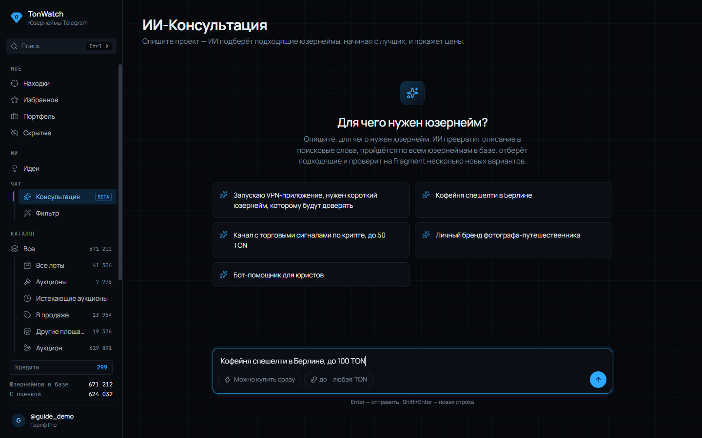
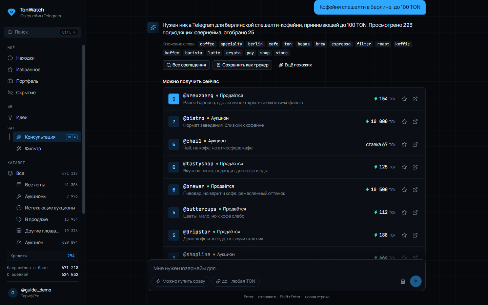
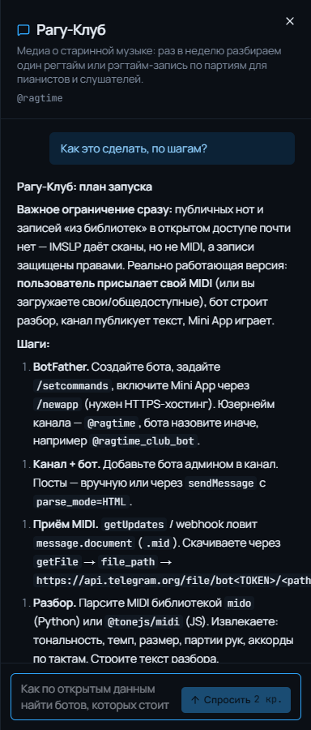
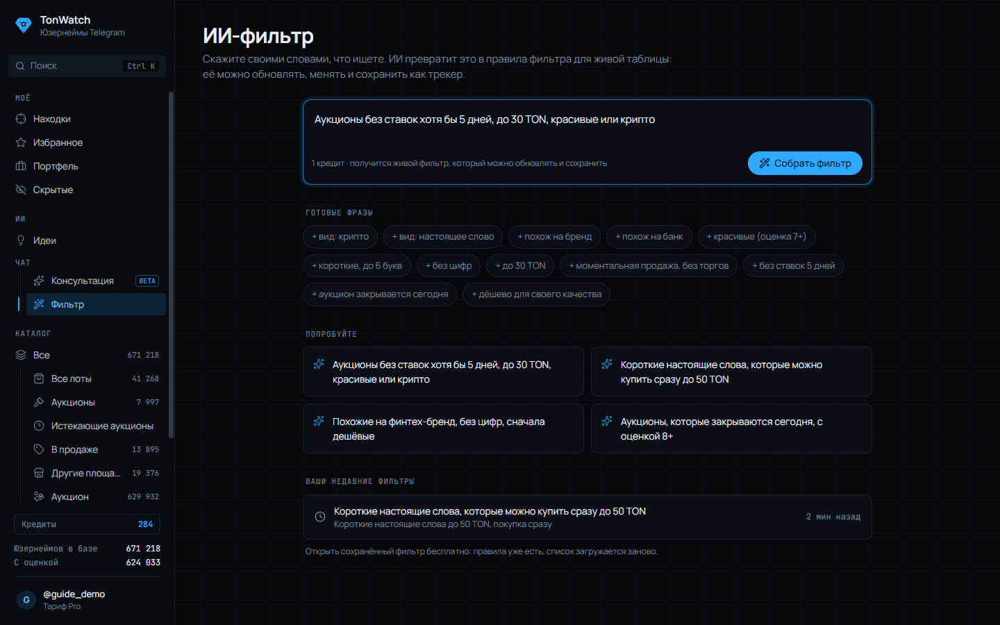

# Чаты с ИИ: консультация, чат по идее и ИИ-фильтр

В TonWatch с ИИ можно говорить в трёх местах. Все они помнят ваши настройки «О себе» и «Никогда не предлагать» и тратят кредиты: их баланс виден в боковом меню, а бесплатные кредиты можно забирать каждый день.

## Консультация: подобрать юзернейм под задачу

Раздел «Консультация» в боковом меню. Опишите обычными словами, для чего нужен юзернейм:

- «Запускаю VPN-приложение, нужен короткий юзернейм, которому будут доверять»
- «Кофейня спешелти в Берлине»
- «Канал с торговыми сигналами по крипте, до 50 TON»

Можно сразу ограничить цену и оставить только то, что покупается без торгов.

ИИ превратит описание в ключевые слова, пройдётся по всем юзернеймам в базе и отберёт подходящие (5 кредитов). В ответе:

- **Можно получить сейчас** — юзернеймы в продаже, с ценой и тем, насколько каждый подходит под запрос;
- **Уже заняты** — владельцу можно предложить цену;
- **Новые варианты, проверенные на Fragment** — придуманы под ваш запрос, некоторые могут быть свободны.

Под ответом есть кнопки: «Все совпадения» открывает полный список в каталоге, «Сохранить как трекер» следит за новыми совпадениями, «Ещё похожих» продолжает подбор.

## Чат по идее: как запустить проект

У каждой идеи из раздела Идеи есть свой чат. Спрашивайте что угодно о разработке и запуске:

- «Как это сделать, по шагам?»
- «На какие открытые данные или API это опирается?»
- «Как привлечь первых 100 пользователей?»

Каждый ответ стоит 2 кредита, переписка сохраняется вместе с идеей.

## ИИ-фильтр: каталог словами

Раздел «Фильтр». Вместо десятка галочек напишите, что нужно: «аукционы без ставок хотя бы 5 дней, до 30 TON, красивые или крипто». Можно собрать запрос из готовых фраз или взять пример. Недавние фильтры открываются повторно бесплатно.

ИИ соберёт живой фильтр (1 кредит): обычные фильтры каталога, которые можно поправить руками, обновить или сохранить как трекер. Если что-то из запроса учесть не получилось, он скажет об этом.

## Сколько стоит

- Разбор одного юзернейма (лампочка) — 1 кредит
- Разбор всей подборки «Почему эти N» — 5
- ИИ-фильтр — 1
- Консультация — 5
- Подборка идей — 10
- Заменить идею — 3
- Ещё такое — 2
- Под себя — бесплатно
- Сообщение в чате по идее — 2
