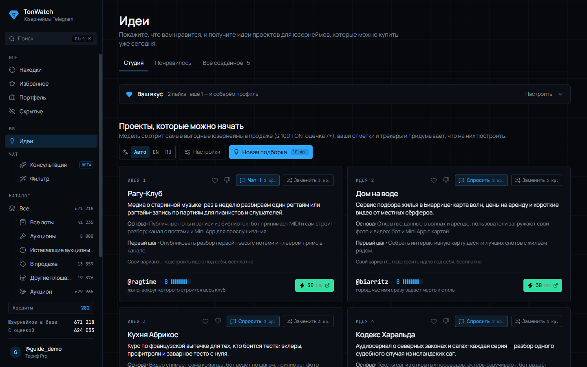
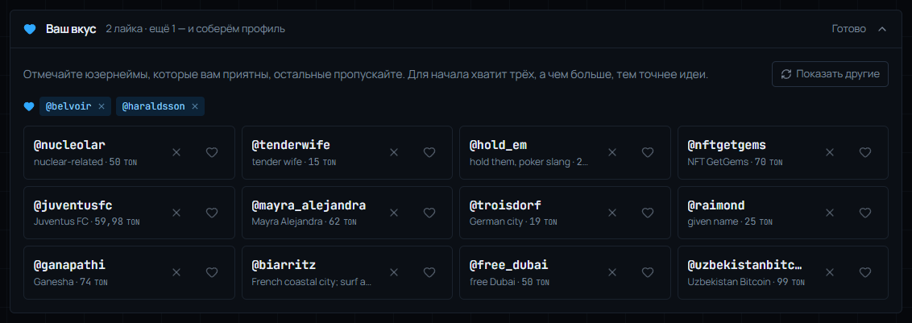
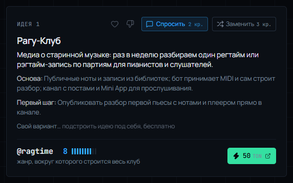

# Идеи: проекты под юзернеймы, которые можно купить

В Идеях ИИ берёт юзернеймы в продаже из выбранного вами источника и придумывает, что на них можно построить: канал, бот, сервис или бренд. Учитываются те же настройки поиска, что и в Находках: бюджет, минимальная оценка, «О себе» и «Никогда не предлагать».

## Сначала — ваш вкус

Раскройте блок «Ваш вкус» кнопкой «Настроить». Вам покажут юзернеймы из продажи: отмечайте сердечком те, что нравятся, крестиком пропускайте остальные. «Показать другие» подгружает новую порцию. Для начала хватит трёх лайков, а чем их больше, тем точнее идеи. Ещё ИИ учитывает избранное, покупки и юзернеймы, на которых вы задерживаетесь.

## Откуда брать юзернеймы

Над подборкой есть переключатель «Юзернеймы из»:

- **По вкусу** — понравившиеся юзернеймы в продаже, лучшие из ваших трекеров, ваши категории и самые выгодные в рамках настроек поиска. Выбрано по умолчанию.
- **Избранное** — только то, что вы лайкнули или добавили в избранное, если это продаётся. Бюджет здесь не учитывается.
- **Снайпы** — только юзернеймы в рамках настроек поиска.
- **Трекер** — юзернеймы одного вашего трекера.

Рядом видно, сколько юзернеймов сейчас в этом источнике и сколько из них ИИ смотрит за одну подборку. Выбор запоминается. Юзернеймы из последних подборок откладываются, пока есть другие, так что каждая «Новая подборка» показывает новые имена.

## Подборка идей

Нажмите «Придумать идеи», а в следующий раз — «Новая подборка» (10 кредитов). Рядом можно выбрать язык ответа: Авто, EN или RU. Каждая идея — это:

- название проекта и короткое описание;
- **Основа** — на чём проект держится: данные, бот, Mini App;
- **Первый шаг** — с чего начать уже сегодня;
- внизу — юзернейм из продажи с оценкой и кнопкой покупки.

Что можно сделать с идеей:

- **♥ / 👎** — нравится или нет. Следующие подборки учтут это.
- **Спросить** — открыть чат по идее: как сделать, запустить и сколько брать (2 кредита за сообщение, см. гайд по чатам с ИИ).
- **Заменить** — вместо этой идеи придумать новую на других юзернеймах (3 кредита).
- **Свой вариант…** — подстроить идею своими словами, например «упор на аудио, я живу в Лиссабоне». Бесплатно.

## Понравилось и вся история

На вкладке **Понравилось** — идеи с сердечком, они направляют каждую новую подборку. На вкладке **Всё созданное** хранятся все подборки, замены и чаты; есть поиск по юзернейму или названию. На обеих вкладках есть кнопка **Ещё такое** — ещё один проект в том же духе (2 кредита). Новые подборки не повторяют старые идеи и по возможности берут другие юзернеймы.
