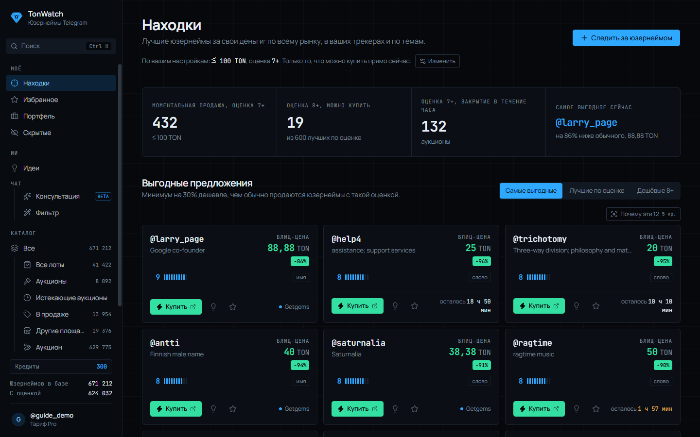
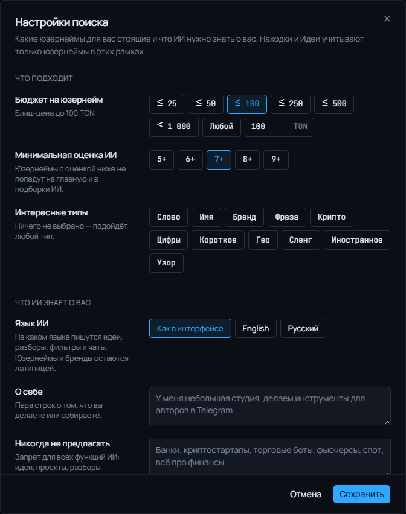
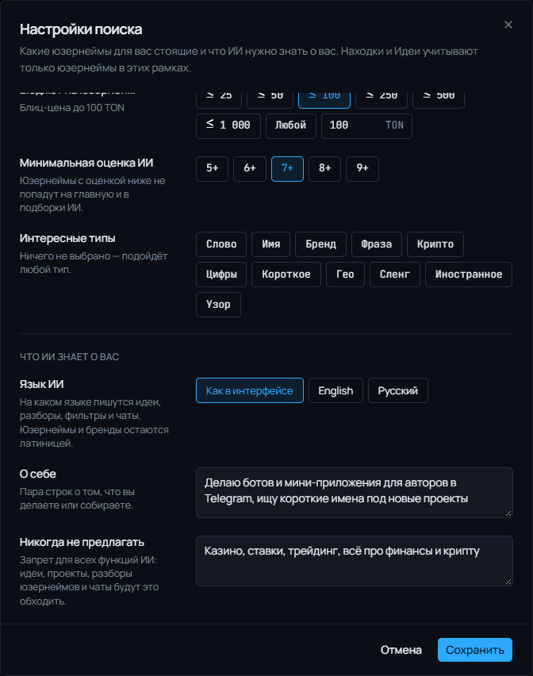
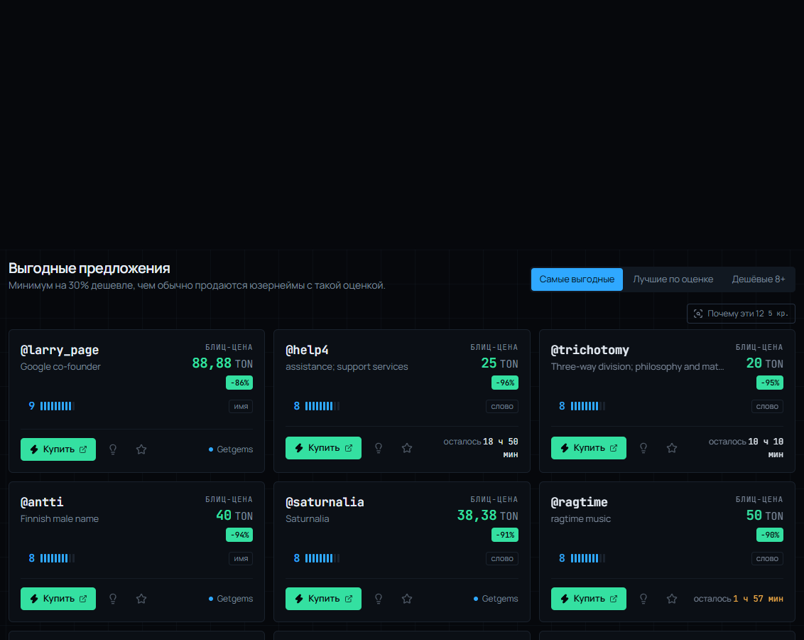
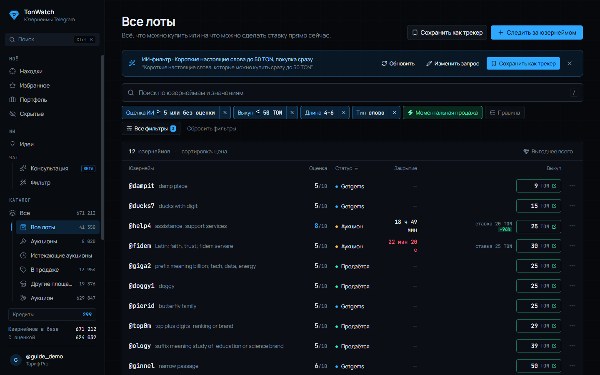

# Находки: как настроить поиск выгодных юзернеймов

Находки — главная страница TonWatch. Здесь собрано только то, что можно купить прямо сейчас: аукционы, блиц-цены и лоты на маркетплейсах. Что именно попадёт сюда, решаете вы в настройках поиска.

## Настройки поиска

Откройте их кнопкой «Изменить» над цифрами или в меню профиля.

**Что подходит**

- **Бюджет на юзернейм** — потолок блиц-цены: 25, 50, 100 TON и так далее, своя сумма или «Любой».
- **Минимальная оценка ИИ** — от 5+ до 9+. Всё, что ниже, не попадёт ни на главную, ни в подборки ИИ.
- **Интересные типы** — крипто, настоящие слова, бренды и другие. С них начинают Идеи; Находки всё равно показывают все типы.

**Что ИИ знает о вас**

- **Язык ИИ** — на каком языке писать идеи, разборы, фильтры и чаты: как в интерфейсе, английский или русский.
- **О себе** — позитивный промпт. Пара строк о том, чем вы занимаетесь или что собираете, например: «Небольшая студия, делаем инструменты для авторов в Telegram». ИИ учитывает это в разборах, идеях и чатах.
- **Никогда не предлагать** — негативный промпт. То, что вам точно не нужно: «банки, криптостартапы, торговые боты, всё про финансы». Запрет действует во всех функциях ИИ сразу.

**Тариф и уведомления**

На Pro бот присылает в Telegram новые юзернеймы в рамках ваших настроек, аукционы из избранного за час до конца и снижения цен. Кнопка «Отправить тест» проверяет, что уведомления доходят.

## Цифры сверху

Четыре плитки показывают, что есть на рынке под ваши настройки: сколько юзернеймов продаётся без торгов, сколько из них с высокой оценкой, какие аукционы закрываются в ближайший час и самое выгодное предложение прямо сейчас. Нажмите на плитку, и откроется полный список в каталоге.

## Выгодные предложения

Три переключателя:

- **Самые выгодные** — минимум на 30% дешевле, чем обычно продаются юзернеймы с такой оценкой.
- **Лучшие по оценке** — самая высокая оценка ИИ среди того, что можно купить, сначала дешёвые.
- **Дешёвые 8+** — самые низкие цены среди юзернеймов с оценкой от 8.

На каждой карточке: цена и насколько она ниже обычной, оценка ИИ, тип и время до конца аукциона. Кнопки:

- **Купить / Ставка** — сразу ведёт на Fragment или маркетплейс.
- **Лампочка** — короткий разбор от ИИ: для какого проекта подходит юзернейм и насколько он подходит вам (1 кредит).
- **Почему эти N** — разобрать всю подборку одним запросом, это заметно дешевле (5 кредитов).
- **Звёздочка** — в избранное, тогда придёт напоминание о конце аукциона.
- **Крестик** (появляется при наведении) — «не моё». Юзернейм пропадёт отовсюду, а ИИ запомнит, что такое вам не нравится.

## Трекеры и вдохновение

**Из ваших трекеров** — лучшие юзернеймы из каждого сохранённого поиска и счётчик новых с прошлого визита.

**Для вдохновения** — сильные юзернеймы по темам с подсказкой, для чего они могут пригодиться.

## Фильтры

Если нужно точнее, откройте **Каталог**: там фильтры по типу, длине, цене, оценке, статусу и времени до конца аукциона. Любой набор фильтров можно сохранить как трекер.

Ещё проще — **ИИ-фильтр**: опишите словами, что ищете, например «аукционы без ставок 5 дней, до 30 TON, красивые или крипто», и ИИ соберёт фильтр сам (1 кредит). Готовый фильтр можно обновлять и сохранить как трекер.

